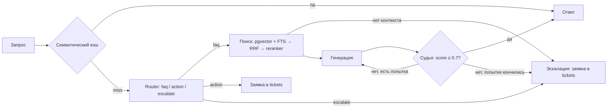

# Support RAG Agent

Агент первой линии поддержки на **LangGraph + PostgreSQL (pgvector)**. Отвечает на вопросы по базе знаний,
оформляет заявки на действия с аккаунтом и передаёт сложные обращения человеку. Каждый ответ проверяется
LLM-судьёй на соответствие найденным документам: непроверенный ответ клиенту не отдаётся.

База знаний — 42 статьи поддержки вымышленного облачного хранилища «Нимбус» (`data/kb/`), написанные для
проекта. К ним — eval-набор из 76 вопросов с эталонными документами и ответами (`data/eval/questions.jsonl`).

## Как устроено



**Поиск.** Два независимых поиска по чанкам:
- векторный — `intfloat/multilingual-e5-small` (с префиксами `query:` / `passage:`, как требует E5), HNSW-индекс pgvector;
- полнотекстовый — встроенный FTS PostgreSQL с русским стеммингом, термы объединяются через OR, ранжирование `ts_rank_cd`.

Результаты объединяются через Reciprocal Rank Fusion и переранжируются мультиязычным cross-encoder'ом
`cross-encoder/mmarco-mMiniLMv2-L12-H384-v1`. Режим поиска переключается переменной `RETRIEVAL_MODE` —
это нужно для абляции ниже.

**Проверка ответа.** Судья возвращает оценку 0–10. Если оценку не удалось разобрать, она считается нулевой
(fail-closed). Ответ ниже порога перегенерируется в строгом режиме; если и вторая попытка не прошла —
обращение уходит человеку. Судьёй может быть отдельная, более сильная модель (`JUDGE_*` в `.env`).

**Действия.** Внутренних API (биллинг, сессии) у проекта нет, поэтому агент не изображает выполнение
операции, а создаёт заявку в таблице `tickets` и сообщает её номер. Это точка интеграции: запись в таблицу
заменяется вызовом настоящего API без изменений в графе.

**Кэш.** Кэшируются только FAQ-ответы, прошедшие проверку. TTL — 24 часа, после загрузки базы знаний кэш
очищается. Порог близости строгий (0.95): у E5 косинусная близость даже несвязанных фраз около 0.7–0.85.

## Результаты

### Абляция поиска

65 FAQ-вопросов, метрики на уровне документов. Воспроизвести: `python -m scripts.eval_retrieval`.

| Режим | Hit@1 | Recall@3 | Recall@5 | MRR@10 |
|---|---|---|---|---|
| fts | 0.538 | 0.731 | 0.831 | 0.664 |
| vector | — | — | — | — |
| hybrid (RRF) | — | — | — | — |
| vector + reranker | — | — | — | — |
| hybrid + reranker | — | — | — | — |

Строка `fts` посчитана на PostgreSQL 16. Остальные строки заполняются после прогона скрипта с моделями —
таблица вместе с задержками сохраняется в `results/retrieval_ablation.md`.

Промахи полнотекстового поиска — перефразированные вопросы без общих слов с документом
(«Перезаписал таблицу, можно откатить на вчерашний вариант?» → «История версий файлов»).
Именно на них должен выигрывать векторный поиск.

### Агент и задержка

| Метрика | Значение | Как получить |
|---|---|---|
| Точность роутера (76 вопросов) | — | `python -m scripts.eval_agent` |
| FAQ: прошли проверку с первой попытки | — | там же |
| FAQ: доля эскалаций | — | там же |
| RAGAS faithfulness / context recall | — | `python -m scripts.eval_agent --ragas` |
| Задержка: полный проход, p50 / p95 | — | `python -m scripts.bench_latency` |
| Задержка: попадание в кэш, p50 / p95 | — | там же |

Указывайте рядом с цифрами модель LLM и железо, на котором делали замер.

## Запуск

Нужны Docker и ~6 ГБ свободной памяти.

```bash
cp .env.example .env            # поменяйте POSTGRES_PASSWORD
docker compose up -d --build
docker compose exec ollama ollama pull qwen2.5:3b
docker compose exec api python -m src.ingest data/kb
```

Первый запуск API скачивает модели поиска (~600 МБ) в volume `models-cache`.

```bash
curl -s localhost:8000/api/v1/chat -H 'Content-Type: application/json' \
  -d '{"query": "Подписка сама продлилась, можно вернуть деньги?"}'
```

**Через OpenRouter вместо локальной модели:** в `.env` раскомментируйте блок OpenRouter и запустите
только `docker compose up -d postgres api`.

**Оценка** (внутри контейнера, где уже есть модели):

```bash
docker compose exec api python -m scripts.eval_retrieval
docker compose exec api python -m scripts.eval_agent
docker compose exec api python -m scripts.bench_latency --url http://localhost:8000
```

`eval_agent` создаёт заявки в `tickets` — запускайте его на тестовой базе.

**Тесты** не требуют БД и моделей:

```bash
pip install -r requirements-dev.txt
pytest
```

В CI (`.github/workflows/ci.yml`) дополнительно проверяется схема и полнотекстовый поиск на настоящем
Postgres с pgvector и сборка Docker-образа.

## Структура

```
src/
  agent.py      граф LangGraph и узлы
  routing.py    решения о переходах (чистые функции, покрыты тестами)
  parsing.py    разбор ответов LLM, fail-closed
  retriever.py  векторный, полнотекстовый и гибридный поиск, reranker
  fusion.py     RRF и построение FTS-запроса
  models.py     ленивая загрузка эмбеддера и reranker'а
  cache.py      семантический кэш
  tools.py      действия агента (заявки)
  db.py         пул соединений и схема
  ingest.py     загрузка базы знаний
  server.py     FastAPI
scripts/        оценка поиска, агента, задержки; smoke-тест FTS для CI
data/kb/        база знаний
data/eval/      вопросы с эталонами
tests/          unit-тесты
```

## Ограничения

- База знаний синтетическая и небольшая (42 статьи, каждая — один чанк). На реальном корпусе из тысяч
  документов картина абляции может отличаться.
- Полнотекстовый поиск PostgreSQL — не BM25: `ts_rank_cd` не учитывает IDF. Для BM25 можно подключить
  ParadeDB `pg_search`.
- Маленькая локальная модель — слабый судья для самой себя. Для честных цифр задайте отдельного судью.
- Кэш проверяется до роутера: просьба о действии, очень похожая на закэшированный FAQ-вопрос, получит
  FAQ-ответ. Строгий порог делает это редким, но не исключает.
- Нет аутентификации и rate limiting — это демо-сервис.
